<p align="center">
  
</p>

# エスパー ESPER 操作マニュアル

ESPER（Ejecta Spectro-Photometry analyzER）v3.2.0 は、JAXA/ISAS 二段式軽ガス銃の衝突実験で撮影した Phantom v2512 の分光動画（0次光＋1次分光像、48,000 fps）から、イジェクタ（破片）の**並進速度・自転周期・灰色体温度・サイズ**を求めるソフトウェアです。
このページはその操作マニュアルです。例は 2407 shot2（A5083 板、SUS304 φ2 mm、約 7 km/s）。

**PDF 版（A4、21 ページ）：[MANUAL.pdf](MANUAL.pdf)**　・　[画像つき HTML 版](index.html)

> このリポジトリにはマニュアルだけを置いています。ソフトウェア本体（macOS の dmg、Windows のインストーラ）とソースコードは公開していません。

## 目次

- [動画マニュアル](#動画マニュアル)
- [インストールと起動](#インストールと起動)
- [1. 実験とショットの選択](#1-実験とショットの選択)
- [2. 設定の確認と変更](#2-設定の確認と変更)
- [3. 再生と表示](#3-再生と表示)
- [4. 検出と追跡](#4-検出と追跡)
- [5. 自動分類](#5-自動分類)
- [6. トラックの選択](#6-トラックの選択)
- [7. 光度曲線と自転周期](#7-光度曲線と自転周期)
- [8. スペクトル](#8-スペクトル)
- [9. 温度の時間変化](#9-温度の時間変化)
- [10. サイズ分布](#10-サイズ分布)
- [11. 一括解析](#11-一括解析)
- [12. スナップショット](#12-スナップショット)
- [13. 全自動解析と解析動画](#13-全自動解析と解析動画)
- [14. 0次光と1次光の直径の関係](#14-0次光と1次光の直径の関係)
- [コマンドラインでの全自動解析](#コマンドラインでの全自動解析)
- [同梱データ](#同梱データ実験ログ感度曲線較正)
- [出力ファイル](#出力ファイル)
- [注意点](#注意点)
- [ライセンス・連絡先](#ライセンス連絡先)

## 動画マニュアル

インストールから画面の操作までを、音声と字幕つきで順に説明しています（6 分 12 秒）。下の各節は、動画と同じ順番です。
画像をクリックすると動画のページが開きます（「View raw」で再生できます）。

[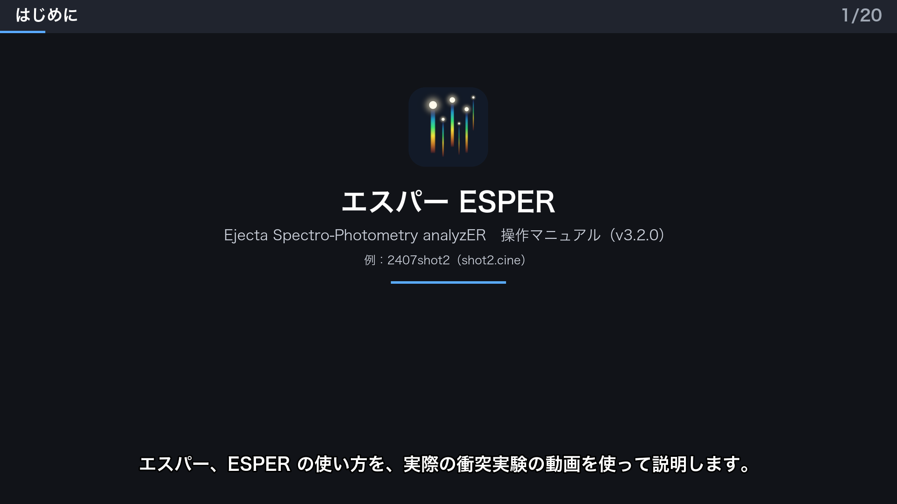](video/esper_manual_720p.mp4)

[720p](video/esper_manual_720p.mp4)・[1080p](video/esper_manual.mp4)・[字幕（srt）](video/esper_manual.srt)・[画像つき HTML 版](index.html)

## インストールと起動

| OS | ファイル | 入れ方 |
|---|---|---|
| macOS | `ESPER-3.2.0-mac-arm64.dmg`（Apple シリコン）<br>`ESPER-3.2.0-mac-x86_64.dmg`（Intel） | dmg を開いて ESPER.app を「アプリケーション」へ。初回は右クリック →「開く」（署名なしのため） |
| Windows | `ESPER-3.2.0-windows-setup.exe`<br>`ESPER-3.2.0-windows.zip` | インストーラを実行（zip なら展開して `ESPER.exe`）。「PC が保護されました」が出たら「詳細情報」→「実行」 |

アプリには、実験ログ（`JAXA衝突実験Log.xlsx`）、全実験の感度曲線（`response/`）、波長較正・絶対較正と実験カタログ（`calib/`）、このマニュアルが入っています。
実験データ（cine）は入っていません。起動後、設定タブの **［データフォルダ…］** で、年月ごとのフォルダ（`202510/` など）がある場所を選んでください（例：`/xxx/JAXA_impact`。次回以降も記憶します）。
メニュー「ヘルプ」から、このマニュアルとバージョン情報を開けます。

データフォルダは、アプリと同じ場所に `data` という名前で置くこともできます。データが別のディスクにあるときは、シンボリックリンクにします（macOS のターミナルで、アプリのある場所で実行）：

```sh
ln -s /xxx/JAXA_impact data      # /xxx は実験データのある場所
```

環境変数 `ESPER_DATA` でも指定できます。優先順は ESPER_DATA →［データフォルダ…］で選んだ場所 → アプリの隣の `data` です。

読める動画は、Phantom の元の cine ファイル（10-bit packed のモノクロ、2203〜2609 のすべて）と、avi・mp4・mov です。
カラー（Bayer）の cine は読み込み時にエラーで知らせます。avi・mp4 のフレームレートは再生用の値なので使いません。実撮影のフレームレートを設定タブで入れてください。

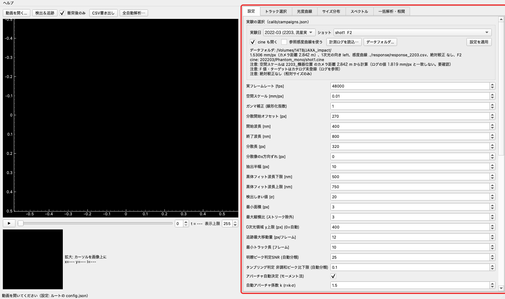
*起動直後。左が動画、右が「設定」「トラック選択」「光度曲線」「サイズ分布」「スペクトル」「一括解析・相関」の 6 タブ。*

## 1. 実験とショットの選択

設定タブのいちばん上の「実験の選択」で、**実験日**と**ショット**を選び、**［設定を適用］** を押します。次の値がすべて自動で入り、「cine も開く」に印があれば元の cine が開きます。

- 空間スケール（カメラ距離から）と、センサー上の 1次光の向き
- 波長較正、感度曲線（装置応答）、絶対較正 K(λ)
- 撮影 F 値（計測ログから）、1次光の x ずれ（全ショット解析での実測値）
- 検出・温度フィット・絶対サイズの解析設定（全ショット解析と同じ）

フレームレートと露光時間は cine のヘッダから読み、衝突の閃光のフレームを自動で見つけます。cine は「データフォルダ」から読みます。見つからないときは、選択欄の下に「この cine が見つからない」と出ます。

感度曲線がない、またはおかしい実験では「参照感度曲線を使う」に印を付けます（感度曲線がない実験では自動で使います）。参照感度曲線は 9 回の実験の中央値で、温度フィットの範囲（480–780 nm）でのばらつきは約 5% です。

### 計測ログ（xlsx）

同梱の計測ログ `JAXA衝突実験Log.xlsx` は起動時に自動で読み込まれ、ショットごとに日付・プロジェクタイルと速度・ターゲット・真空度・Phantom mono の F 値・フレームレート・露光・コメントが選択欄の下に表示されます。
別のログを使うときは **［計測ログを読込…］** を押します。ログの F 値がカタログと違うときは、ログの値を使い、違いを一覧で知らせます。

| 読むシート | 読む内容 |
|---|---|
| `<年月>_shot記録` | 日付、プロジェクタイル（種類・サイズ・質量・実測速度・エネルギー）、ターゲット、真空度、Phantom（モノクロ分光）の F 値・fps・露光・備考、コメント |
| `<年月>_計測log` | 2311 以前の形式。日付、プロジェクタイル、ターゲット、圧力（mono の F 値は欄の区別がないため読まない） |
| `<年月>_機材配置` | Phantom Mono の「窓-ターゲット中心」＋「マウント面-窓」＝カメラ距離 |

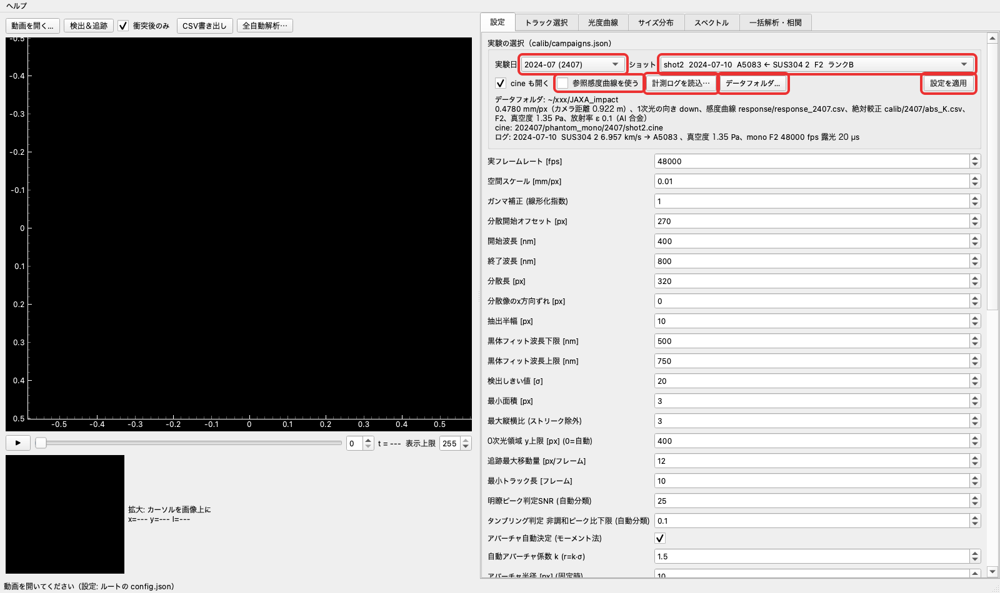
*実験日とショットを選ぶ。ショットの行には日付、ターゲット、F 値、トリアージのランクが出る。下の段に「参照感度曲線を使う」「計測ログを読込…」「データフォルダ…」。*

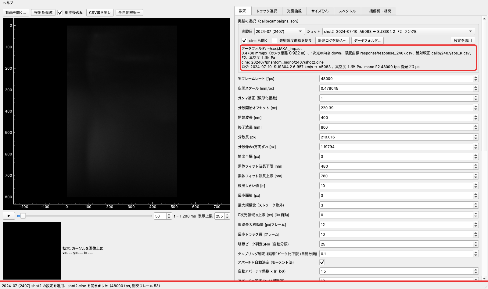
*適用後。選択欄の下に、データフォルダ、使う較正ファイル、ターゲットの材料から決めた放射率 ε、計測ログの内容、注意事項が出る。ステータスバーにフレームレートと衝突フレーム。*

## 2. 設定の確認と変更

値は設定タブで確認でき、変えるとすぐに表示と解析に反映されます。カタログにない動画は **［動画を開く…］** で開き、**［設定を読込…］**（JSON）と **［波長較正JSONを読込…］** で設定します。

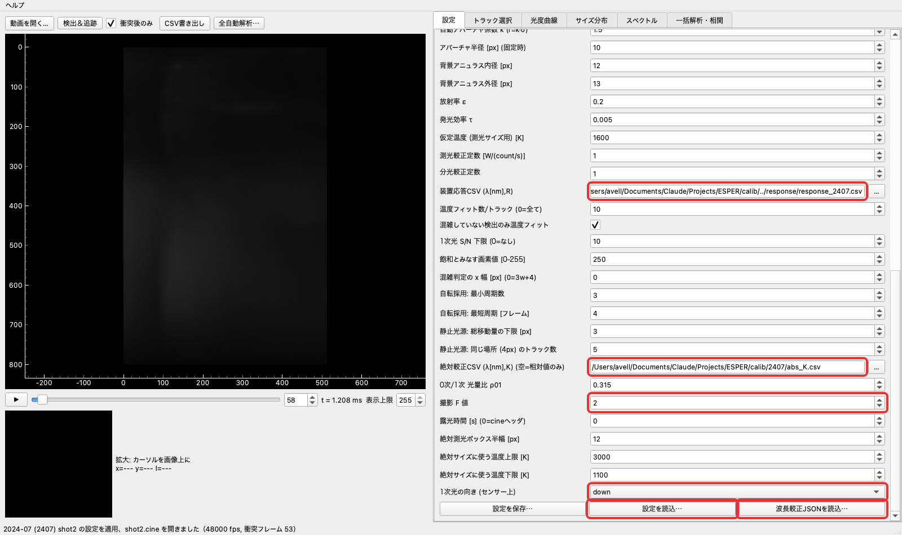
*感度曲線・絶対較正のファイル、F 値、1次光の向き（down / up / left / right）。2203・2307 は left、2208 は up。*

## 3. 再生と表示

スライダーや ▶ でフレームを送ります。上の点が 0次光（破片そのもの）、その下に縦に伸びる帯が 1次の分光像です。
暗い破片が見えにくいときは、スライダー右の「表示上限」を下げます（解析には影響しません）。

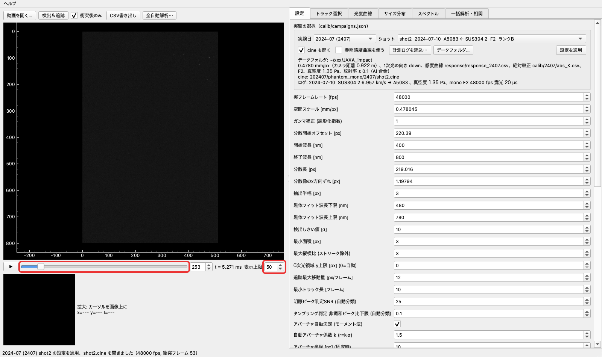
*表示上限 50。左下の拡大鏡はカーソルの周り ±15 px を拡大し、黄色の円が測光の開口。*

## 4. 検出と追跡

**［検出＆追跡］** で、0次光を全フレームで検出し、フレーム間でつないでトラックにします。「衝突後のみ」に印があると、衝突フレームの 5 フレーム後から検出します（全自動解析と同じ）。

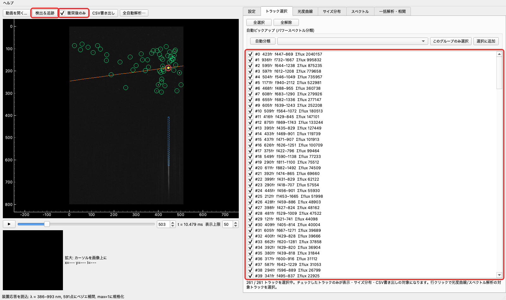
*緑の丸が検出されたトラック。一覧のチェックが、表示・サイズ分布・一括解析の対象。*

## 5. 自動分類

**［自動分類］** で、各トラックの明るさの変動をパワースペクトルで調べ、「明瞭ピーク」「タンブリング」「周期性なし」「データ不足」に分けます。**［このグループのみ選択］** でまとめて選べます。

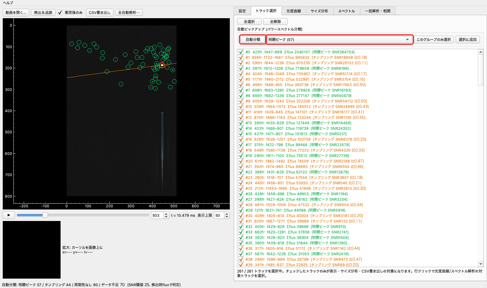
*緑＝明瞭ピーク、橙＝タンブリング、灰＝データ不足。*

## 6. トラックの選択

一覧の行か、動画上の緑の丸をクリックすると、そのトラックが光度曲線とスペクトルの対象になります。
赤丸＝選択中、橙線＝軌跡、黄円＝測光の開口、青破線＝1次光の抽出帯。

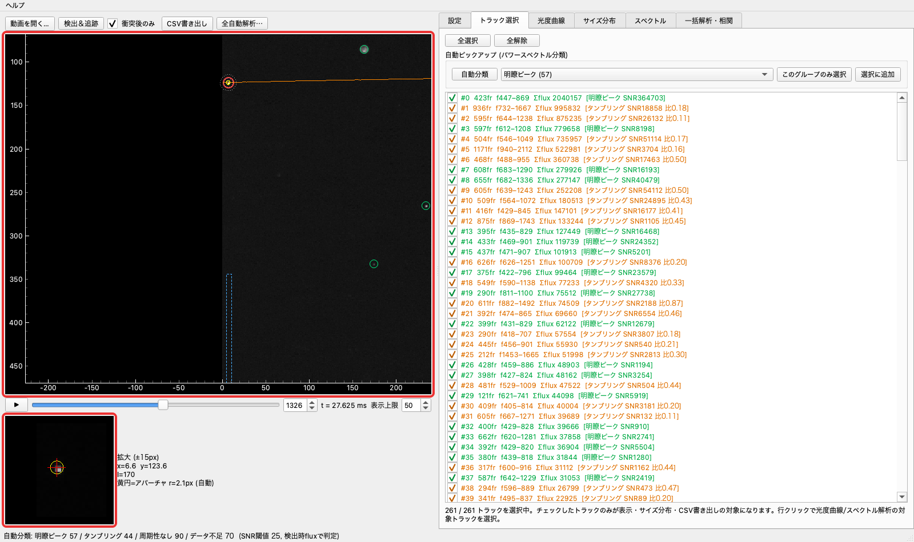
*抽出帯（青破線）は 0次光の下 disp_offset_px から disp_length_px 行。*

## 7. 光度曲線と自転周期

光度曲線タブの **［光度曲線を解析］** で、開口測光の光度曲線、パワースペクトル、並進速度、自転周期を求めます。
自転周期は「1 回転で明るさが 2 回変わる」と仮定し、変動周期の 2 倍としています。

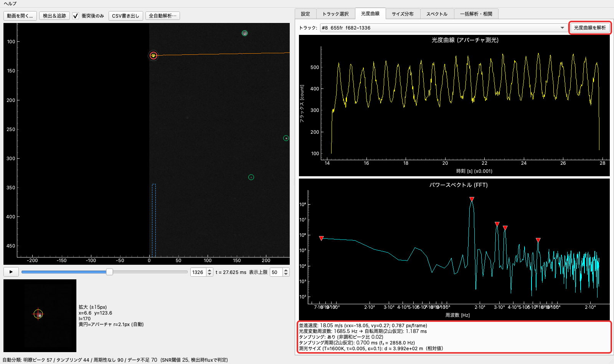
*この破片は 1,686 Hz の変動 → 自転周期 1.19 ms、並進速度 18 m/s。*

## 8. スペクトル

スペクトルタブには、選択トラックの今のフレームの 1次光スペクトルと灰色体フィットが出ます。
灰＝生の値、白＝感度曲線で割った値、緑破線＝感度曲線、赤＝フィット、青破線＝フィット範囲（480–780 nm）。

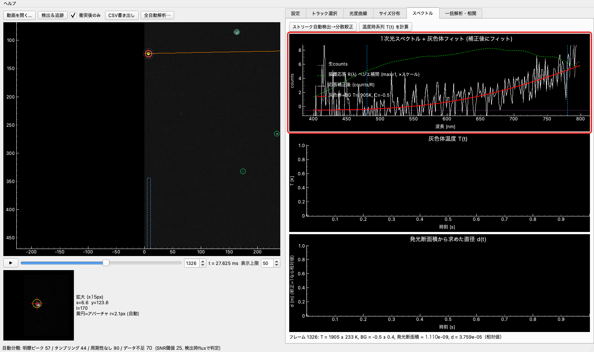
*周りの光源と重ならないフレーム（1次 S/N 最大）。T = 1,905 ± 233 K。*

## 9. 温度の時間変化

**［温度時系列 T(t) を計算］** で、トラックの全フレームで灰色体をフィットします。一括解析と同じ選別（1次光の帯に他の光源が重なる「混雑」、飽和、1次 S/N）を通ったフレームを赤、外れたフレームを灰で描きます。

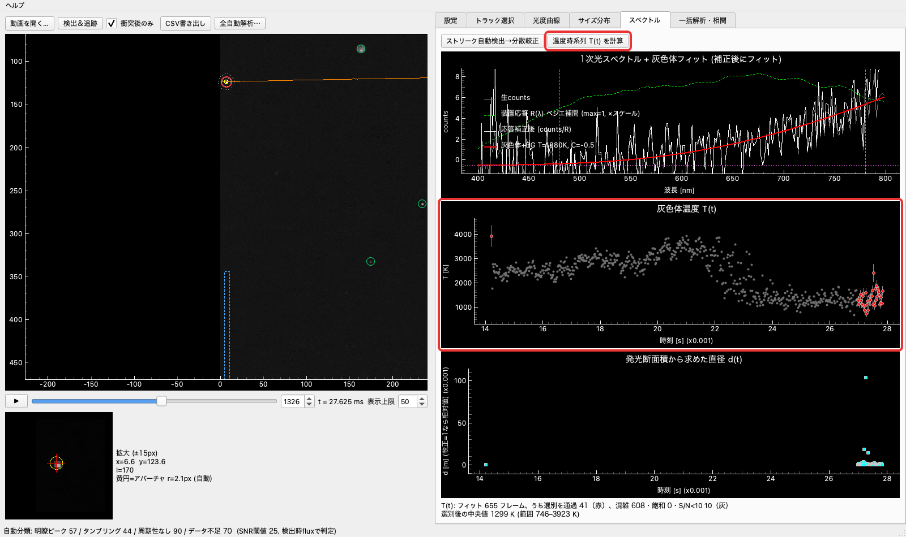
*灰の点（混雑したフレーム）は 2,500–4,000 K に偏る。選別後の中央値は 1,335 K。*

## 10. サイズ分布

サイズ分布タブで、チェックした全トラックの測光サイズから累積分布 N(>d) を作り、べき指数 q をフィットします。フィット範囲は自動で選ばれます。

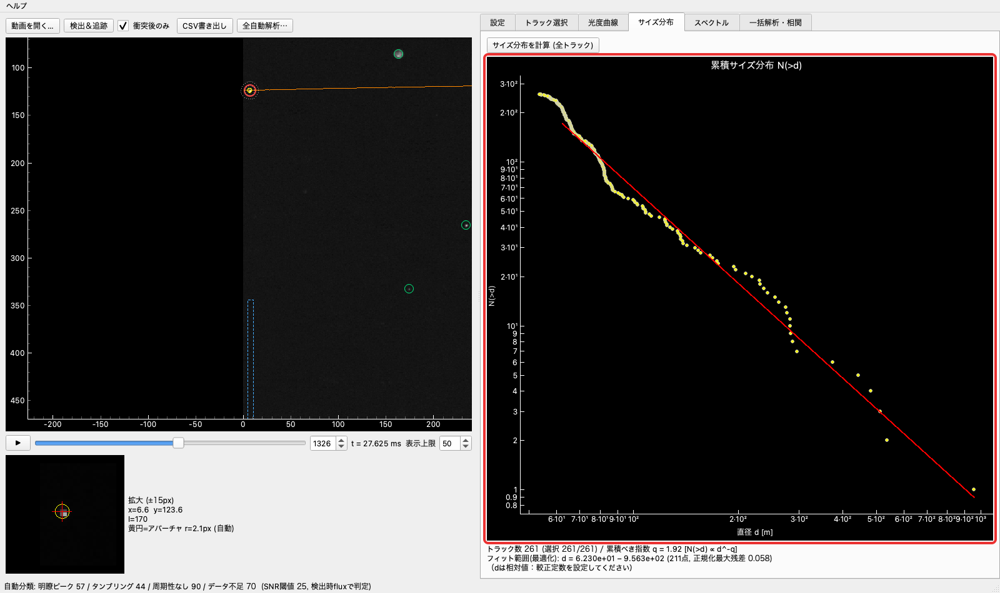

## 11. 一括解析

**［一括解析 (選択トラック)］** で、選択した全トラックの速度、自転周期、温度、サイズを、動画を 1 回読むだけでまとめて計算します。
絶対較正が設定されていれば、サイズは mm 単位の絶対値です。**［結果を1つのCSVに保存…］** で 1 トラック 1 行の表に書き出します。

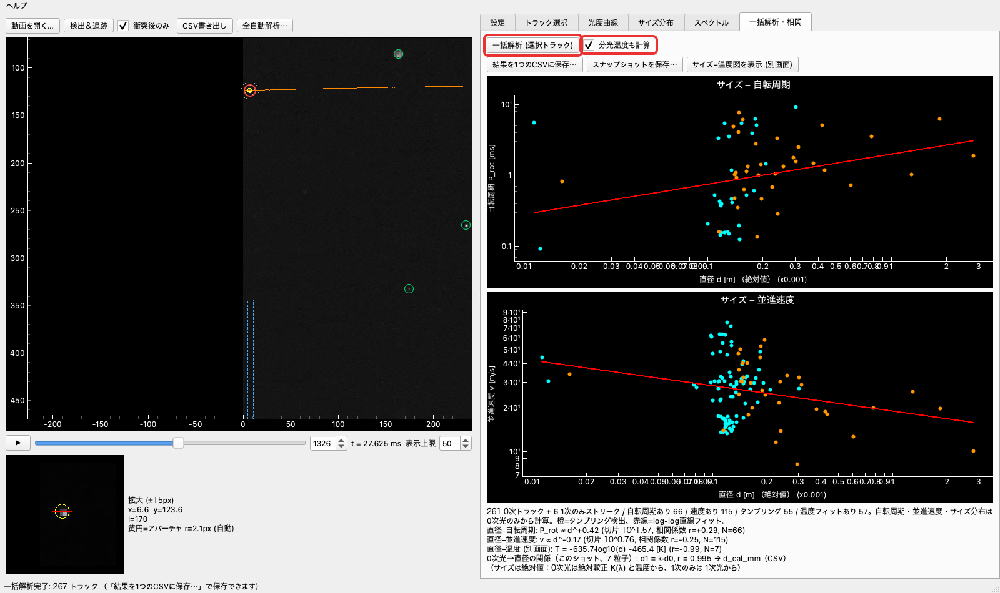
*上：直径–自転周期、下：直径–並進速度。水色＝明瞭ピーク、橙＝タンブリング。*

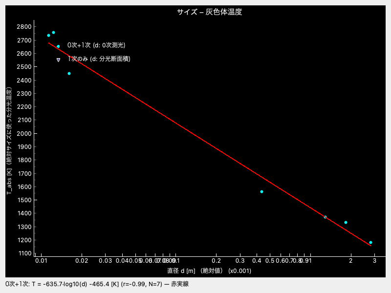
*別画面の直径–温度図。縦軸は絶対サイズに使った分光温度（1,100–3,000 K）。*

## 12. スナップショット

**［スナップショットを保存…］** で、解析した粒子と、温度を求めたときのスペクトルを図に残します。全自動解析では毎回自動で保存されます（`<名前>_snap/`）。
赤＝温度あり、緑＝自転を採用、水色＝その他、灰＝静止光源。

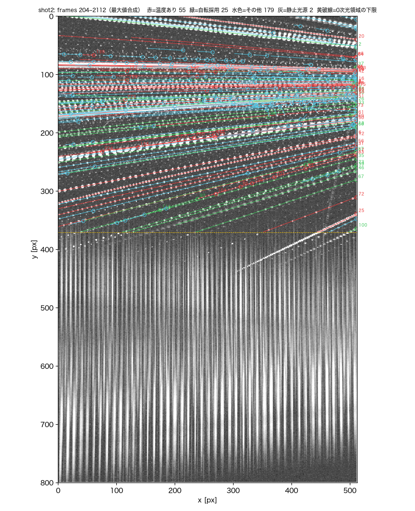
*`overview.png`：解析範囲の最大値合成に、全粒子の軌跡と番号。*

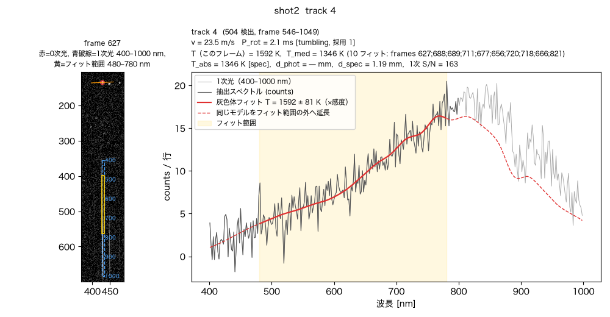
*`spec_<番号>.png`：使ったフレームの 0次光（赤）、1次光 400–1000 nm（青破線）とフィット範囲 480–780 nm（黄）、スペクトル（黒＝取り出した 400–800 nm、灰＝1000 nm まで）と灰色体フィット（赤実線、感度を掛けて生のカウントに戻したもの）。赤破線は同じモデルをフィット範囲の外へ延ばしたもので、800–1000 nm の実測と合えば、波長較正とモデルが近赤外でも合っていることがわかる。*

## 13. 全自動解析と解析動画

**［全自動解析…］** は、衝突フレームの検出、検出と追跡、一括解析、0次光の直径の較正、スナップショット、ファイルの書き出しまでを一度に行います（コマンドラインで `--headless` を付けて実行したときと同じ処理）。
選んだショットがトリアージの**ランク A** のときは、解析動画 `<名前>_analysis.mp4` も保存します。

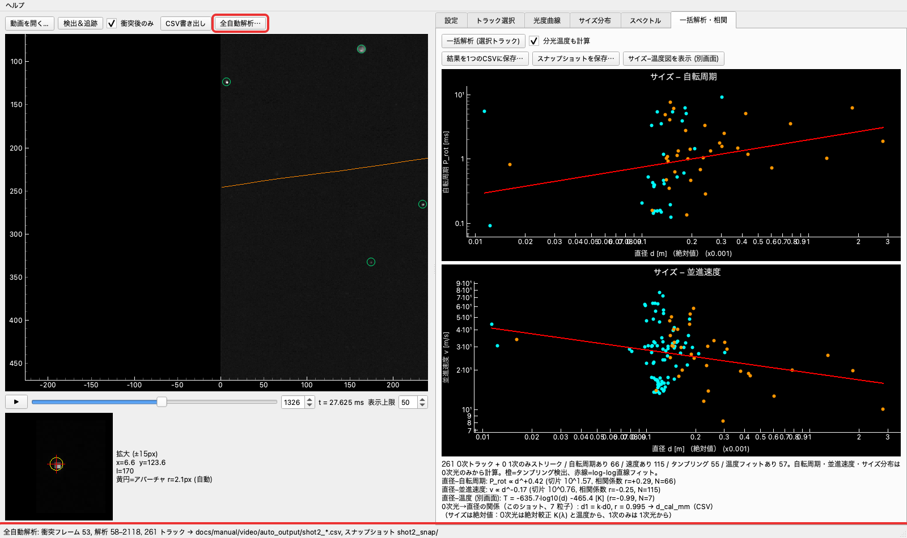

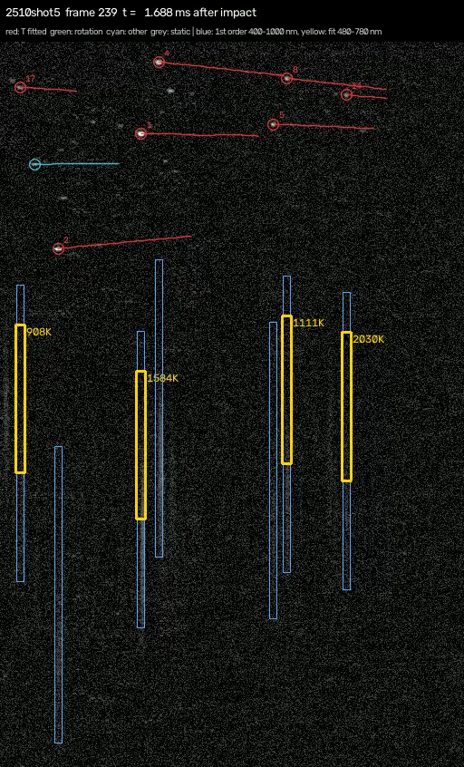
*解析動画（2510 shot5）：粒子の位置・軌跡・番号（赤＝温度あり、緑＝自転を採用、水色＝その他）。温度を求めた粒子には 1次光全体（400–1000 nm、青の細枠）を描き、温度フィットに使ったフレームでは、フィット範囲（480–780 nm、黄色の太枠）と、そのフレームの温度を描く。1,500 K 前後の粒子の光は 650–1000 nm（ピーク 820–860 nm）に集まるので、明るい筋は黄色の枠より下に見える。*

## 14. 0次光と1次光の直径の関係

1次光の直径 d1（スペクトルと温度から）は、温度フィットが通った粒子にしか出ません。
そこでショットごとに、0次光の直径 d0（または 0次光の光量 C0）と d1 の関係を次の 4 通りで当てはめ、相関係数 r（対数で）が最も高いものを採用します。この関係で、すべての粒子の直径 `d_cal_mm` を 0次光から計算します。

| 関係 | 式 | 説明 |
|---|---|---|
| 比例 | `d1 = k·d0` | パラメータ 1 個 |
| べき | `d1 = a·d0^b` | r は比例と同じ。残差が 10% 以上小さいときだけ採用 |
| 一次式 | `d1 = a + b·d0` | |
| 光量のべき | `d1 = a·C0^b` | 温度を使わない |

粒子が 5 個未満のショットには関係式を作りません（全ショットの集計では、同じターゲット材のショットをまとめた関係を使います）。

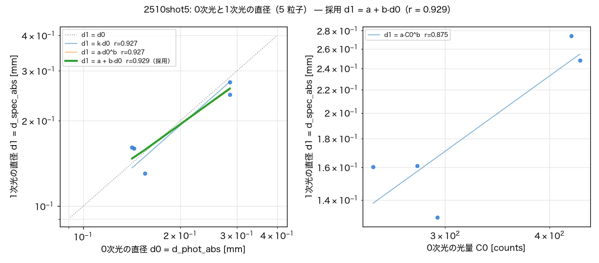
*`<名前>_size_relation.png`（2510 shot5、5 粒子）：左が d0 との関係、右が光量 C0 との関係。太線が採用した式（一次式、r = 0.926）。*

## コマンドラインでの全自動解析

GUI を使わずに、アプリ本体をコマンドラインから実行できます（macOS のアプリ：`/Applications/ESPER.app/Contents/MacOS/ESPER`、Windows：インストール先の `ESPER-cli.exe`。以下では `ESPER` と書きます）。

```sh
ESPER --headless --shot 2510shot3 --out OUT                 # カタログのショット
ESPER --headless --shot 2510shot3 --out OUT --video         # 解析動画も
ESPER --headless --shot 2503shot6 --out OUT --ref-response  # 参照感度曲線で
ESPER --headless shot.cine --config cfg.json --wavecal wavecal.json --out OUT
ESPER --shot 2510shot3                                      # GUI をショットを選んだ状態で起動
#   --name NAME  --max-tracks N  --no-snapshots
```

データフォルダは環境変数で指定できます（例：macOS `ESPER_DATA=/xxx/JAXA_impact ESPER --headless --shot 2510shot3 --out OUT`、Windows `set ESPER_DATA=X:\xxx\JAXA_impact` のあと `ESPER-cli.exe --headless …`）。

## 同梱データ（実験ログ・感度曲線・較正）

アプリの中に、次のデータが入っています（macOS では ESPER.app を右クリック →「パッケージの内容を表示」→ Contents/Resources）。

| 場所 | 中身 |
|---|---|
| `log/JAXA衝突実験Log.xlsx` | 実験ログ（日付・条件・真空度・F 値・カメラ距離・コメント） |
| `response/response_<年月>.csv` | 各実験の感度曲線。列 `lambda [nm]`、`R [-]`（ハロゲンランプ Lamp_5054 で校正した相対感度、最大 1）。先頭の `#` 行に由来と単位 |
| `response/raw/` | ハロゲン記録から作ったすべての曲線（使わなかった記録、形が崩れた 2503・2609 を含む） |
| `response/reference/` | 参照感度曲線（9 実験の中央値）、ばらつき、各曲線の判定 `check.csv`（ずれ dev > 0.10 で要確認） |
| `calib/<年月>/wavecal.json` | 波長較正（Hg ランプ）：分散の開始位置・長さ、nm/px、1次光の向き |
| `calib/<年月>/abs_K.csv` | 絶対較正 K(λ)（ランプをターゲット位置に置いた 1次光の応答） |
| `calib/campaigns.json` | 実験カタログ：カメラ距離・空間スケール・向き、ショットごとの日付・ターゲット・F 値・cine の場所 |

参照感度曲線を使ったときの温度のずれ（9 実験での範囲）：

| 真の温度 | 1,300 K | 1,600 K | 2,000 K | 3,000 K |
|---|---|---|---|---|
| ずれ | −5〜+9% | −6〜+10% | −8〜+11% | −14〜+13% |

2503 と 2609 はハロゲンの記録が使えないため、感度曲線と絶対較正はそれぞれ 2508・2510 のもの。感度曲線のない実験（2210、2603 など）は参照感度曲線を使う。
2403 の絶対較正は他の年度の 1/2〜1/3 で参考値。2203・2208・2307（流星実験）は空間スケールが未確認で、絶対較正はありません。

## 出力ファイル

| ファイル | 中身 |
|---|---|
| `<名前>_tracks.csv` | 1 トラック 1 行（49 列）。速度 `v_m_s`、自転周期 `P_rot_ms` と採否 `rot_ok`、温度 `T_med_K`・`T_abs_K`、直径 `d_phot_abs_mm`・`d_spec_abs_mm`・`d_cal_mm`、温度フィットのフレーム `spec_frames` など |
| `<名前>_meta.json` | 衝突フレーム、解析範囲、fps、露光、トリガー時刻、x ずれ、直径の関係式 |
| `<名前>_config.json` | 使った設定のすべて |
| `<名前>_sizedist.csv` | 累積サイズ分布（静止光源を除く） |
| `<名前>_size_relation.png` | 0次光と1次光の直径の関係 |
| `<名前>_snap/` | スナップショット（overview.png、spec_<番号>.png、index.csv） |
| `<名前>_analysis.mp4` | 解析動画（ランク A、または `--video`） |

## 注意点

- 絶対直径は温度にとても敏感です（d ∝ exp(hc/2λkT)。1,450 K と 1,370 K で 1.5 倍）。温度は 1,100–3,000 K の範囲のものだけを使います。
- 1,500 K 前後の破片の 1次光は、大部分が 650–1000 nm にあります（センサーの感度が 1000 nm で落ちるため、ピークは 820–860 nm）。温度フィットは 480–780 nm で行いますが、同じモデルで 800–1000 nm の実測もほぼ再現できることを確かめています。波長の割り当ての誤差は全体で約 −2 nm（実験ごとに −7〜+3 nm）で、温度への影響は数 % 以内です。
- 感度曲線は約 385–996 nm の範囲で、読み込むときに約 10 nm ごとの点でなめらかにします。v3.1.0 まではなめらかにする点が粗く（約 25 nm ごと）、温度が約 1%（15 K 前後）高めに出ていました。v3.1.1 の結果は、温度が約 1% 低く、1次光から求めた絶対直径が約 6% 大きくなります。
- 放射率 ε はターゲットの材料で決めます（v3.2.0）：Al 合金 0.10、玄武岩 0.90。実験カタログにないショットや材料が未登録の実験では、設定タブの値（既定 0.2）を使います。直径は ε^−1/2 に比例するので、v3.1 までの ε = 0.2 と比べて、Al 合金の直径は 1.41 倍、玄武岩は 0.47 倍になります。温度・速度・自転は ε によりません。Al の値は液体アルミの測定（632.8 nm で 0.04）と Al の光学定数（480–830 nm で 0.08–0.13）、玄武岩の値は 0.85–1.2 µm の測定（約 0.95）と溶融時の低下から決めました。
- 暗い光源や、1次光の帯に他の光源が重なるフレームでは、温度が 2,500–5,000 K に偏ります。温度は選別を通ったフレームだけで判断してください。
- 自転周期は「1 回転で 2 回明るくなる」仮定です。形によっては変動周期そのものが自転周期のこともあります。
- 0次光の d0 と 1次光の d1 は同じ温度を使うので、相関の一部は温度を共有していることによります。光量の関係（C0）は温度を使いません。
- 解析の実行中は、再生とフレーム送りが止まります（同じファイルを読むため）。

## ライセンス・連絡先

エスパー ESPER (Ejecta Spectro-Photometry analyzER) v3.2.0
Copyright © 2026 Abe Laboratory, Department of Aerospace Engineering, Nihon University. All rights reserved.
連絡先：Shinsuke Abe &lt;abe.shinsuke@nihon-u.ac.jp&gt;

ロゴ：[`logo/esper_logo.png`](logo/esper_logo.png)（正方形、1024×1024）・[`logo/esper_logo_wide.png`](logo/esper_logo_wide.png)（横長、1600×400）

<p></p>

本ソフトウェア（同梱の実験ログ・感度曲線・較正データ、本マニュアルを含む）の利用・複製・再配布・改変については、連絡先にお問い合わせください（[LICENSE](LICENSE)）。
